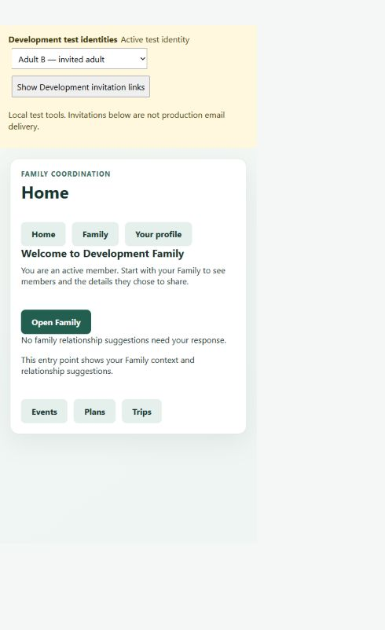

# VER-WI-075-001 — Invited Adult First-Use Journey

## Metadata

- **Subject:** `WI-075-001`
- **Date:** 2026-09-28
- **Context baseline:** `CTX-1.23`
- **Verifier:** Implementing agent
- **Independence:** `SELF-VERIFIED`
- **Model tier:** `DEEP`
- **Result:** `PASS`
- **Completion authorized:** `YES`
- **Authority:** Project owner explicitly approved execution in the 2026-09-28 session. PRP-022 and the skippable-profile/Development-scenario decisions were approved in that session. Canonical requirements were not changed.

## Implemented scope

The root now presents a minimal Home and locally selected existing areas. An invitation fragment opens a focused response. Successful acceptance returns the committed Family ID, then reloads active memberships and that Family's directory and relationships. Only successful context loading advances to recommended, skippable profile review. Failed loading retains the accepted state and retries reads without resubmitting the consumed invitation.

The profile, Family directory, relationship, Event, Plan, and Trip controls reuse their existing behavior. A keyed workspace under a Development session component owns all user-specific state. Switching identity destroys that workspace, cancels its HTTP subscriptions (including the Trip component), clears outbox presentation and the invitation fragment, and mounts a fresh workspace for the selected account. Stale initial membership/directory/relationship responses cannot overwrite the accepted Family handoff.

The opt-in scenario uses an isolated `FamilySafety_Invitation_...` database and the existing schema. It seeds A as active administrator and B as an existing Account/Profile with no membership. Re-running the startup script without a scenario name creates a fresh database; resuming a named scenario preserves its membership state. No ordinary Development database is deleted or reset.

## API changes

| Operation | Change | Boundary |
|---|---|---|
| `POST /api/membership-invitations/accept` | Successful response changes from 204 to 200 with `{ familyGroupId }` | ID comes from the successfully committed acceptance transaction; no new eligibility or access rules |
| `GET /api/development/identities` | Added only when Development switching is enabled; returns two fixture identities and configured default | No production route; no arbitrary account list |
| Development account resolution | Request-scoped `X-Development-Account` selects only A or B when switching is enabled | Invalid/multiple/unknown values produce no current account; absent header uses the configured allowlisted default; non-Development activation is rejected |
| Development outbox | Existing `/api/development/invitation-outbox` reused with a small Development UI | In-memory link inspection, not production email |

No model/schema/migration or domain lifecycle changes. The repository acceptance return value was extended to carry the committed Family ID; SQL transaction, capacity, and eligibility checks remain intact. Preview still returns only Family name and inviter display name.

## UI and navigation changes

- Added `DevelopmentSession` as the bootstrap component and a guarded HTTP interceptor. Its keyed `App` child provides identity isolation.
- Existing `App` becomes `app-workspace`, with focused invitation, handoff, profile, Family, minimal Home, and locally selected Event/Plan/Trip sections. Existing forms are retained and hidden outside their selected area.
- Existing `Trips` cancels subscriptions on destruction. No Trip feature or access behavior changed.
- No new router definitions; `app.routes.ts` is unchanged. Final navigation and mobile grouping remain undecided.
- Home reports only Family context and loaded relationship suggestions. It makes no universal attention/notification claim.

## Test and build evidence

| Command / activity | Result |
|---|---|
| `dotnet build FamilySafety.slnx --no-restore` | PASS, 0 warnings, 0 errors |
| `dotnet test FamilySafety.slnx --no-restore --logger "trx;LogFileName=wi075-unit.trx"` | PASS, 125 tests; SQL-gated bodies were not enabled in this preliminary run |
| `$env:RUN_FAMILYSAFETY_SQL_TESTS='1'` then `dotnet test FamilySafety.slnx --no-build --no-restore --logger "trx;LogFileName=wi075-sql.trx"` | PASS, 125 tests, 0 failed; SQL-gated invitation/concurrency, directory, Event, Plan, Trip/Notes, and new real Development scenario tests enabled |
| `npm test -- --watch=false` in `src/FamilySafety.Web` | Final PASS, 33 tests in 3 files; includes original App/Trip regression tests and 11 first-use test cases |
| `npm run build -- --configuration production` | Final PASS; initial bundle 414.73 kB, estimated transfer 100.07 kB; no budget warning/error |
| `dotnet build FamilySafety.slnx --configuration Release --no-restore` | PASS, 0 warnings, 0 errors |
| Local browser, real API and SQL fixture | PASS, A sends through UI, B starts with no active Family, outbox link previews and accepts, profile skip reaches two-member directory and Home without page refresh |

Raw .NET reports are in `tests/FamilySafety.Foundation.Tests/TestResults/wi075-unit.trx` and `wi075-sql.trx`. Angular/build results were observed in the execution session. The preliminary SQL attempt in the sandbox failed on Windows credentials/event-log access; the same authorized SQL suite passed outside the sandbox. Production Angular builds also required the outside-sandbox execution path after sandbox writes were denied. These were environment restrictions, not relaxed application guards.

SQL tests remain applicable despite no schema changes: the new scenario must prove B has no persisted membership, acceptance returns the correct committed ID, and memberships are unique. The enabled full suite additionally verifies existing transaction concurrency and item-access regressions.

## Acceptance evidence matrix

| Criterion | Evidence | Result |
|---|---|---|
| `AC-01` Focused preview | `first-use.spec.ts` focused response and malformed-token tests; `MembershipInvitationApiTests.PreviewReturnsOnlyApprovedConfirmationFields`; real SQL scenario confirms no membership after preview; browser preview shows only approved Family/inviter context | PASS |
| `AC-02` Accept and decline | UI acceptance and explicit decline tests; existing terminal-lifecycle tests; real SQL scenario acceptance creates exactly one membership | PASS |
| `AC-03` Unavailable/capacity | Existing lifecycle tests cover expiration and terminal states; API uniform 404 test; service failure mapping; Angular 404/409 and malformed-link tests; repository eligibility continues to exclude existing/former memberships | PASS |
| `AC-04` Same-session transition | UI test uses same-named groups with distinct IDs and selects the accepted ID; real browser completes without refresh; stale prior-Family response regression test | PASS |
| `AC-05` Retry | Three UI cases fail membership, directory, and relationship reads separately; each retries reads and asserts no second accept request | PASS |
| `AC-06` Profile review | UI tests exercise approved payload/visibility, save, and skip without PUT; browser exposes recommendation and skip; existing profile privacy suite; SQL scenario proves delivery email not copied | PASS |
| `AC-07` Family handoff | UI test and browser directory show B and relationship entry points; SQL scenario confirms authorized directory and relationship reads; existing directory/relationship suites pass | PASS |
| `AC-08` Minimal Home | UI and browser show Family welcome, scoped relationship-suggestion message, next action, and existing-area links; no universal feed or new dashboard features | PASS |
| `AC-09` Development isolation | `DevelopmentIdentityTests`: allowlist, invalid selection, separate request scopes, Production/Staging rejection, ordinary-database guard, and production endpoint/header isolation; UI test destroys workspace and cancels old Event/Plan/Trip reads | PASS |
| `AC-10` Outbox journey | Real `InvitedAdultScenarioTests` exercises fixture, identities endpoint, A issue, outbox, B preview/accept, membership, directory, and profile privacy; browser completes remaining handoff; documented script provides fresh isolated databases | PASS |
| `AC-11` Regression/boundaries | Full SQL-enabled .NET suite and Angular suites; unchanged domain authorization rules; production header returns unauthorized and Development routes return 404; scoped source review confirms exclusions | PASS |

## Requirement evidence matrix

These are bounded implementation/regression checks, not claims that the full MVP requirement set is complete.

| Requirement | Evidence and interpretation | Result |
|---|---|---|
| `REQ-FAM-005` | Existing administrator-only invitation service/repository plus real A/B scenario; membership starts only on explicit acceptance | PASS |
| `REQ-FAM-006` | Scenario starts with a provisioned Family/A; no operator bootstrap changes or self-service creation path | PASS |
| `REQ-FAM-007` | Profile form and save-payload tests use display name, contact email/phone, birthday month/day only | PASS |
| `REQ-FAM-008` | Invitation service/API/lifecycle/concurrency tests and real SQL acceptance; no lifecycle expansion | PASS |
| `REQ-FAM-009` | Relationship controls retained; existing domain/service/API tests pass; UI entry and descriptive permission copy preserved | PASS |
| `REQ-PRIV-011` | B's preacceptance groups are empty and directory returns 404; postacceptance reads become available through existing server checks | PASS |
| `REQ-PRIV-013` | Existing profile suite covers private defaults, owner updates, filtered reads, and administrator denial; new profile handoff preserves settings | PASS |
| `REQ-PRIV-014` | Hash/fragment token, unavailable, lifecycle and outbox tests; preview field-shaping test; Development guards; no recipient-email ownership claim/copy | PASS |
| `REQ-PRIV-020` | Item sharing semantics unchanged; SQL Plan tests preserve current whole-group access and selected-person limits | PASS |
| `REQ-PRIV-021` | SQL Event selected-viewer/editor tests pass; new Family membership grants no blanket Event audience membership or edit rights | PASS |
| `REQ-PRIV-022` | SQL Trip snapshot/later-joiner, selection, replacement and Notes access regressions pass; UI only adds destroy-time request cancellation | PASS |
| `REQ-UX-001` | Browser Family-first Home and invitation context; no tracking/location surface | PASS |
| `REQ-UX-002` | Home surfaces pending relationship responses before other area actions, with no universal activity feed | PASS |
| `REQ-UX-003` | Focused invitation, optional profile review, and one visible feature section at a time; browser and UI evidence | PASS |
| `REQ-UX-006` | Existing labeled forms and directory filter retained; native button/select interactions verified by keyboard in browser; original label UI test passes | PASS |
| `REQ-UX-007` | Minimal Home identifies Family context and a scoped actionable relationship state | PASS |
| `REQ-UX-008` | Only the bounded attention-first handoff is implemented; full hierarchy and unimplemented attention sources remain deferred | PASS |
| `REQ-UX-011` | Entry links reuse existing areas; no final mobile grouping, Safety destination implementation, or OD-001 resolution | PASS |

## Browser evidence

On 2026-09-28, using `FamilySafety_Invitation_WI075_Browser_20260928`, the tester selected A, issued an invitation to the fixture email, inspected the Development outbox, switched to B, confirmed the no-Family state, opened the same-tab fragment link, saw the approved preview, accepted, skipped profile edits, saw both adults and relationship controls in Family, and reached Home. No reload was used during that journey. Keyboard activation was used for reliable browser automation. The final screenshot was captured after a later source hot reload and reselection of B; it demonstrates the resulting Home/membership state, while the full journey is documented by the observed browser states and the automated tests.

## Exact source/document files changed

Paths are relative to the project root. Generated build/test outputs are listed separately above.

1. `src/FamilySafety.Api/Development/CurrentAccountRegistration.cs`
2. `src/FamilySafety.Api/Development/DevelopmentFixtureRegistration.cs`
3. `src/FamilySafety.Api/Invitations/MembershipInvitationEndpoints.cs`
4. `src/FamilySafety.Api/Program.cs`
5. `src/FamilySafety.Application/Invitations/IMembershipInvitationRepository.cs`
6. `src/FamilySafety.Application/Invitations/IMembershipInvitationService.cs`
7. `src/FamilySafety.Application/Invitations/MembershipInvitationContracts.cs`
8. `src/FamilySafety.Application/Invitations/MembershipInvitationService.cs`
9. `src/FamilySafety.Infrastructure/Persistence/EfMembershipInvitationRepository.cs`
10. `src/FamilySafety.Web/src/main.ts`
11. `src/FamilySafety.Web/src/app/app.config.ts`
12. `src/FamilySafety.Web/src/app/app.ts`
13. `src/FamilySafety.Web/src/app/app.html`
14. `src/FamilySafety.Web/src/app/app.spec.ts`
15. `src/FamilySafety.Web/src/app/trips/trips.ts`
16. `src/FamilySafety.Web/src/app/development-session.ts` (new)
17. `src/FamilySafety.Web/src/app/first-use.spec.ts` (new)
18. `tests/FamilySafety.Foundation.Tests/MembershipInvitationApiTests.cs`
19. `tests/FamilySafety.Foundation.Tests/MembershipInvitationServiceTests.cs`
20. `tests/FamilySafety.Foundation.Tests/MembershipInvitationConcurrencyTests.cs`
21. `tests/FamilySafety.Foundation.Tests/DevelopmentIdentityTests.cs` (new)
22. `tests/FamilySafety.Foundation.Tests/InvitedAdultScenarioTests.cs` (new)
23. `scripts/start-invitation-scenario.ps1` (new)
24. `docs/local-development.md`
25. `ai-context/planning/stories/WI-075-001-invited-adult-first-use-journey.md`
26. `ai-context/planning/verification/VER-WI-075-001.md` (new)
27. `ai-context/planning/verification/evidence/WI-075-001/home-adult-b.png` (new)
28. `ai-context/project-status.md`
29. `ai-context/planning/roadmap.md`

## Limitations and remaining work

- Verification is self-verification; no separate verifier was used.
- Development selection is in memory for one page session; reload/new tab returns to the configured default A. The documented outbox procedure switches first and opens the link in the same tab. This is not production sign-in.
- The outbox is in memory. A restart clears it; resend or use a fresh scenario. Scenario databases are retained by the startup script, not silently dropped.
- Home is intentionally minimal and checks only loaded relationship suggestions. Final route architecture, mobile navigation, full Home, pending-invitation administration, and broader connected product journeys remain later Phase 7.5 work.
- No account registration, recipient-email ownership verification, production email/authentication, member removal, administrator transfer, or expanded permissions were implemented. No Event/Plan/Trip redesign, RSVP/Needs/Updates, Safety, Sharing, Check-In, or notification behavior was added.
- Production identity/email remain undecided, and no new canonical requirement or baseline was introduced.

## Outcome

All 11 acceptance checks and all 18 traced requirements have passing bounded evidence. `WI-075-001` may be marked `DONE`; Phase 7.5 remains `CURRENT`. Recommended next planning topic: a bounded returning-adult entry and Family-context recovery journey. No subsequent story was created or started.
